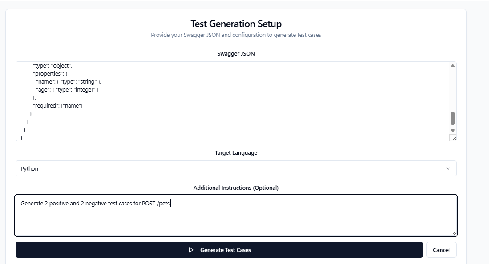
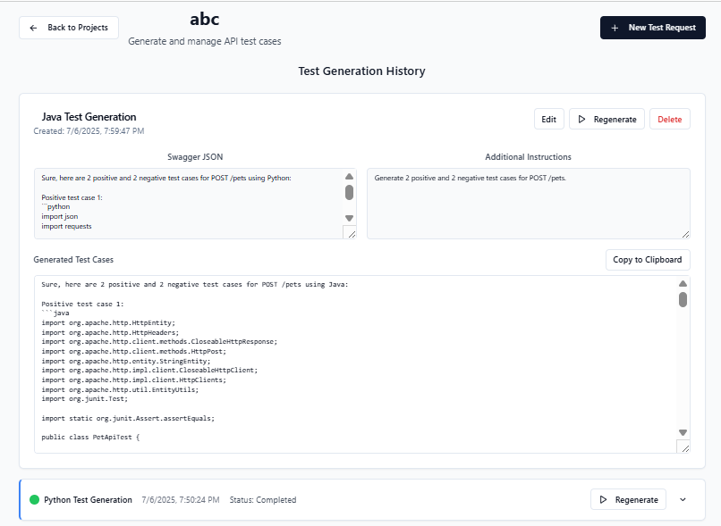
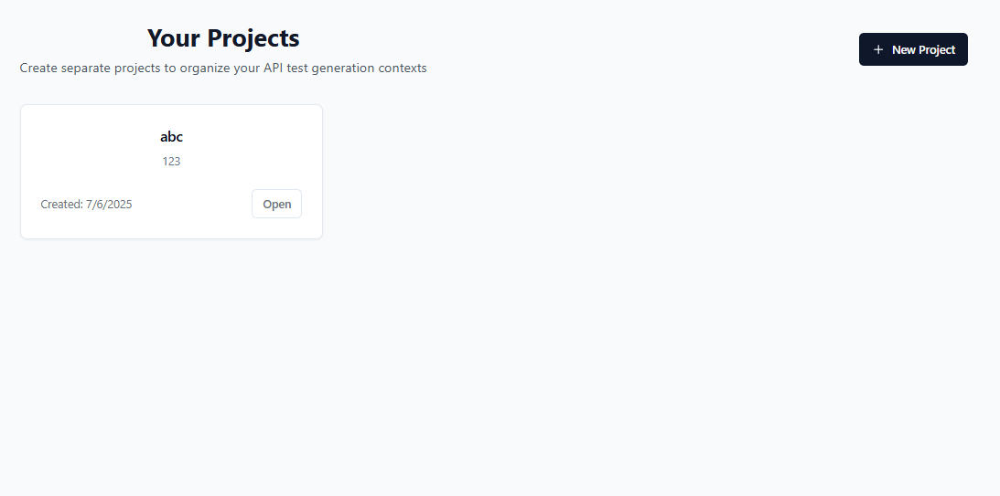
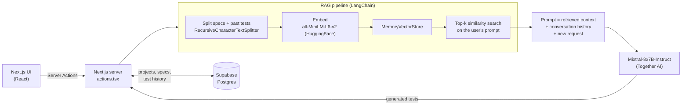

# Context-Aware API Test Generator

Generate ready-to-run API tests from an OpenAPI / Swagger spec using an LLM grounded with Retrieval-Augmented Generation (RAG). Each project keeps its specs and earlier test runs, so every new run builds on what the project has already seen instead of starting from a blank prompt.

Built as my M.Tech (AI & ML) dissertation at BITS Pilani: *Context-Aware Generative AI for Automated API Test Case Generation using RAG and Vector Search* (2025).

## Features

- Upload a Swagger / OpenAPI JSON spec and describe what to test in plain language.
- Generate tests in **Java (REST Assured)**, **C# (RestSharp)** or **Python (Requests)**.
- RAG over the project's history: earlier specs and generated tests are retrieved as context.
- Conversation memory: earlier prompts and answers in the project shape the next run.
- Projects, specs and generated tests are stored in Supabase Postgres; requests can be edited and resubmitted.

## Screenshots

**Set up a run:** paste a Swagger spec, pick a language and describe the tests you want.



**Review results:** each project keeps its history of runs, which feeds the next one as context.



**Projects:** separate projects keep each API's context apart.



## Architecture



### How a run works

1. Load the project's earlier requests (specs and generated tests) from Supabase.
2. Split them, with the new spec, into chunks of 1,000 characters (100 overlap).
3. Embed the chunks with `sentence-transformers/all-MiniLM-L6-v2` and index them in an in-memory vector store.
4. Retrieve the 5 chunks most similar to the user's request.
5. Build one prompt from the retrieved context, the project's conversation history and the new request.
6. Send it to Mixtral-8x7B-Instruct and save the generated tests back to Supabase.

## Tech stack

| Layer | Technology |
| --- | --- |
| Frontend and backend | Next.js 15 (App Router, Server Actions), React 19, TypeScript, Tailwind CSS, Radix UI |
| LLM | Mixtral-8x7B-Instruct via Together AI |
| RAG | LangChain, HuggingFace Inference embeddings (all-MiniLM-L6-v2), MemoryVectorStore |
| Storage | Supabase Postgres |
| Hosting | Cloudflare Workers via OpenNext |

## Getting started

Prerequisites: Node.js 20+, a Supabase project, a Together AI API key and a HuggingFace access token.

```bash
git clone https://github.com/vibhu12345/swagger-tests.git
cd swagger-tests
npm install
cp .env.example .env.local   # then fill in your own values
npm run dev
```

Open http://localhost:3000 and sign in with the `ADMIN_USERNAME` / `ADMIN_PASSWORD` you set.

### Environment variables

| Variable | Purpose |
| --- | --- |
| `SUPABASE_URL` | Supabase project URL |
| `SUPABASE_ANON_KEY` | Supabase anon key |
| `TOGETHER_API_KEY` | Together AI key for Mixtral |
| `HUGGINGFACE_API_KEY` | HuggingFace token for embeddings |
| `ADMIN_USERNAME`, `ADMIN_PASSWORD` | Demo login |

### Database

Create two tables in Supabase:

```sql
create table projects (
  id uuid primary key default gen_random_uuid(),
  slug text unique not null,
  name text not null,
  description text,
  created_at timestamptz default now()
);

create table test_requests (
  id uuid primary key default gen_random_uuid(),
  project_id uuid references projects(id) on delete cascade,
  swagger_json jsonb,
  additional_prompt text,
  selected_language text,
  generated_tests jsonb,
  is_generating boolean default false,
  created_at timestamptz default now()
);
```

Enable Row Level Security on both tables before exposing the app publicly.

## Deploy to Cloudflare

```bash
npx wrangler secret put SUPABASE_ANON_KEY   # repeat for each variable above
npm run deploy
```

## Results and limitations

Compared with LLM-only generation, RAG-grounded runs produced more varied tests (positive and negative scenarios), followed the API schema more closely and repeated less across runs. These are qualitative observations; no formal benchmark has been run yet.

## Roadmap

- Quantitative evaluation: coverage, correctness and execution success against an LLM-only baseline.
- Persistent vector search with pgvector or FAISS instead of an in-memory store.
- Run generated tests in CI/CD (Newman, Pytest) and feed results back into retrieval.
- Publish generated tests directly to a GitHub repository.
- Replace the demo login with Supabase Auth.
